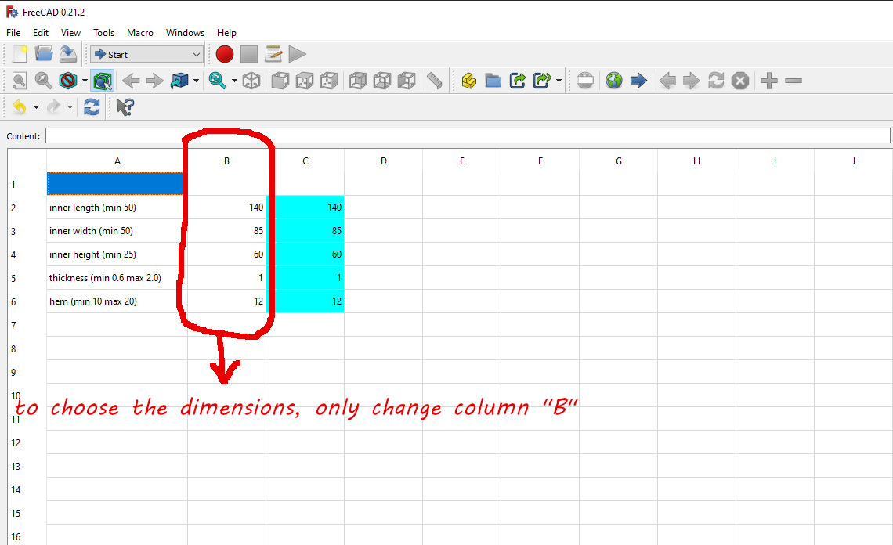
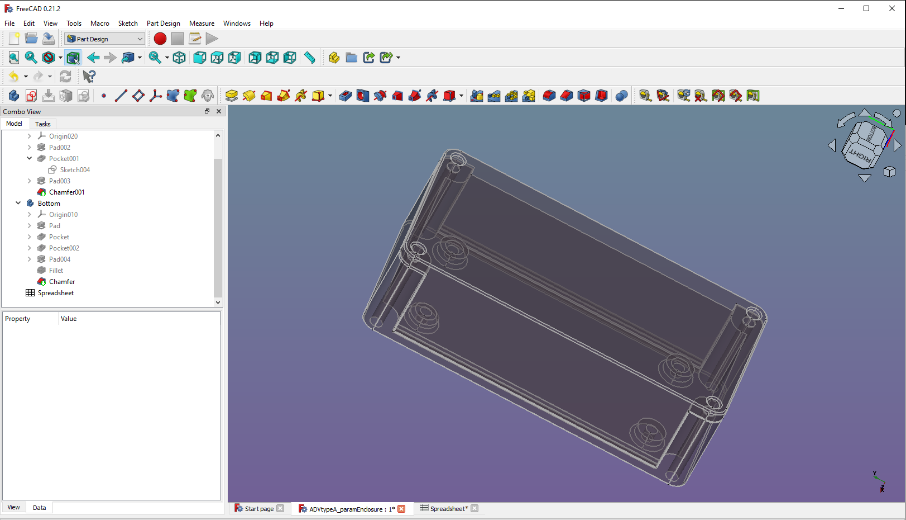
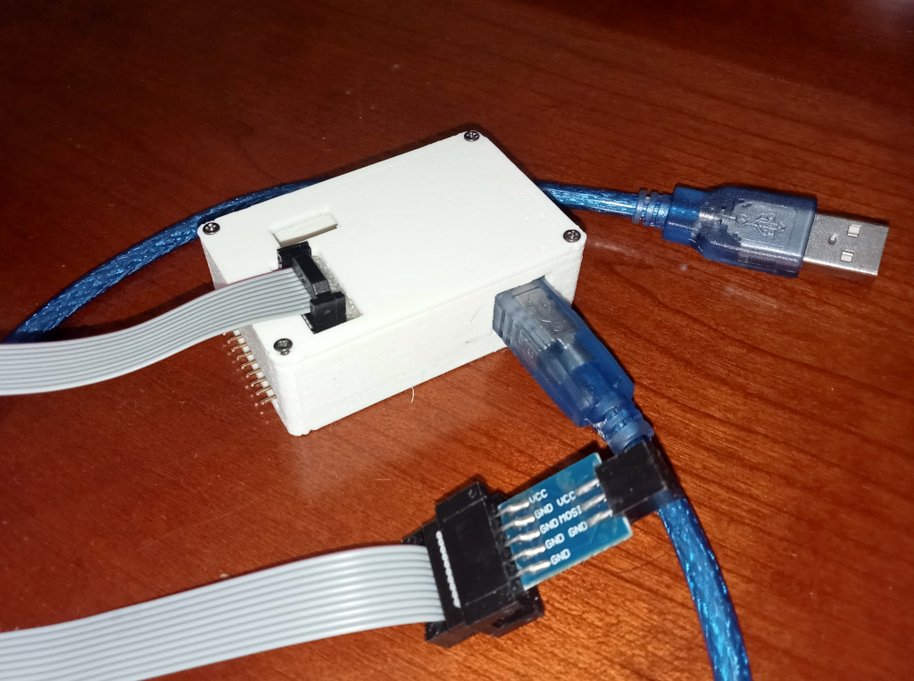
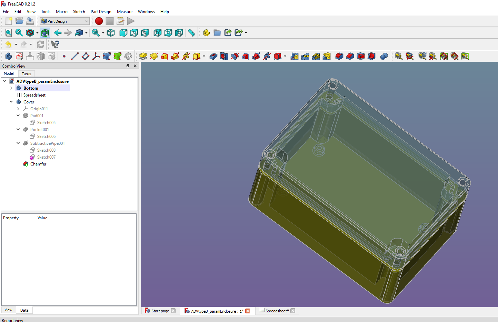
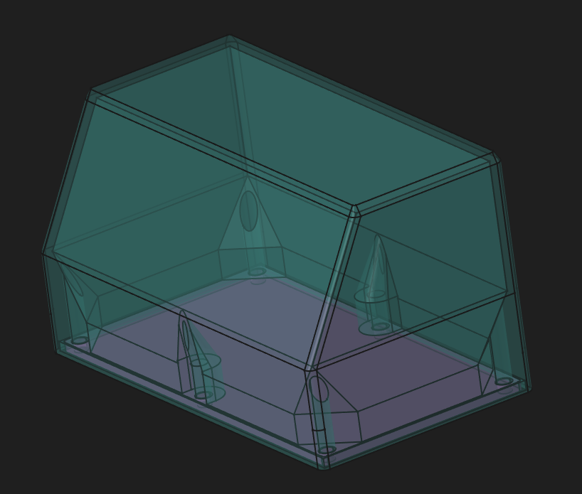

# ADV Parametric Electronics Enclosure made with FreeCAD
Electronics enclosures with parameterized dimensions.
This enclosures serve as a base to most electronic containers I create.
(Designed with FreeCAD 0.21)

## Choice of size
### To choose the dimensions, only change column "B" of the spreadsheet

*Edit the parameters in the FreeCAD spreadsheet to get the correct size.

**Warning! In some drawings you may encounter errors when resizing: try to do it in 5-10 mm steps**

## Model A (FreeCAD)

### Two "U" plastic elements screwed by 2.2 mm self-tapping screw

*Model A view*

*Model A after some cutout windows, a small example to protect an old AVRISP mySmartUSB MK2*

## Model B (FreeCAD)

### Two plastic elements screwed by 4 M3 bolts, with or without 16x2 LCD display
The container includes a channel as a seat for a rubber gasket, if you don't have a suitable one and don't need a high level of airtightness you can also use an electrical wire of the right diameter (this is also parameterized).

*Model B view*

*Model D with LCD 16x2 cutout windows*

## Model T (FreeCAD)

### One rectangular tube, 2 plastic frames and 2 panels screwed by 4 M3 threaded rod and nuts.
Container made using a rectangular tube, two panels (one could be transparent) and two 3D printed frames joined to the panels with remelted pegs.

*Model T views*

## License

MIT License

Copyright (c) 2023 to present Antonio de Vincentiis

Permission is hereby granted, free of charge, to any person obtaining a copy
of this software and associated documentation files (the "Software"), to deal
in the Software without restriction, including without limitation the rights
to use, copy, modify, merge, publish, distribute, sublicense, and/or sell
copies of the Software, and to permit persons to whom the Software is
furnished to do so, subject to the following conditions:

The above copyright notice and this permission notice shall be included in all
copies or substantial portions of the Software.

THE SOFTWARE IS PROVIDED "AS IS", WITHOUT WARRANTY OF ANY KIND, EXPRESS OR
IMPLIED, INCLUDING BUT NOT LIMITED TO THE WARRANTIES OF MERCHANTABILITY,
FITNESS FOR A PARTICULAR PURPOSE AND NONINFRINGEMENT. IN NO EVENT SHALL THE
AUTHORS OR COPYRIGHT HOLDERS BE LIABLE FOR ANY CLAIM, DAMAGES OR OTHER
LIABILITY, WHETHER IN AN ACTION OF CONTRACT, TORT OR OTHERWISE, ARISING FROM,
OUT OF OR IN CONNECTION WITH THE SOFTWARE OR THE USE OR OTHER DEALINGS IN THE
SOFTWARE.